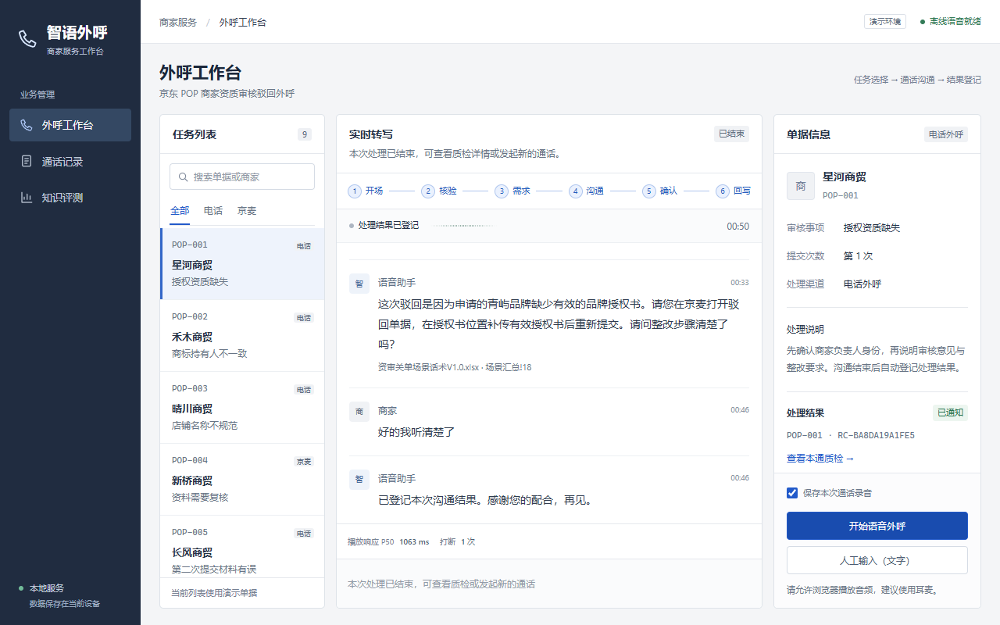

# 智语外呼

第二届北京市大学生“人工智能+”创新大赛赛题 2。作品提供京东 POP 资审驳回服务的完整参赛沙箱。包含内置模拟用例，支持加载原表的 68 条规则，并提供浏览器双向语音、京麦书面处理、联系工单、质检和知识迭代。



本次界面布局、操作和语音验证详见 [UI 验收记录](docs/UI验收记录.md)。

## 启动

需要 Python 3.13（Windows/Linux x64 或 macOS Apple 芯片），以及支持 WebRTC 的 Chrome 或 Edge。建议使用耳麦。

启动时服务器从项目上一级目录或项目内 `reference/` 读取赛事提供的 `[POP资审]资审关单场景话术V1.0.xlsx`。原表在其他位置时，可通过环境变量 `ZHIYU_RULES_FILE` 指定完整路径。服务校验「场景汇总」第 13–80 行及其实际合并单元格内容。加载完整目录后，工作台显示 **68 条原表规则，54 条电话和 14 条京麦**。缺少原表时，工作台会显示目录未加载并进入内置用例模式。源文件和运行日志留在本地。

Windows 双击 `启动智语外呼.cmd`，或在项目根目录运行以下命令。首次启动会下载依赖和离线语音模型。已准备好的环境可加 `--no-fetch`。默认监听本机回环地址。

```powershell
python -X utf8 scripts/launch.py
```

macOS 可双击 `启动智语外呼.command`，或在项目根目录运行 `./启动智语外呼.command`。首次启动需要已安装 `uv` 或 `python3.13`；启动器会在项目内创建 `.venv`，安装依赖并下载语音模型。环境准备完成后可运行 `./启动智语外呼.command --no-fetch` 离线启动。运行期间保持终端窗口打开，按 Ctrl+C 停止服务。

打开 **http://127.0.0.1:8765**。启动日志显示应用就绪后再连接麦克风。配置云端对话 Agent 后，语音和文字入口都会使用该服务。

在左侧任务列表选择 `POP-001`，核对右侧单据信息后点击 **开始语音外呼**。依次说“我是商家负责人”“可以，请说明原因”“授权书在哪里上传”“我明白了，会补齐材料”。可在整改播报中直接开口追问。若整改说明被打断，系统重新说明后请再次确认。成功后可查看回执、质检、来源和原始事件。勾选“保存本次通话录音”才会保存双声道 WAV。工作台仅使用模拟单据。

工作台按“任务列表—通话记录—单据信息”排列。任务支持按单据、商家或事项搜索，并按电话、京麦筛选；通话期间锁定当前单据。**通话记录** 中可按商家、单据、会话编号和处理结果筛选，在详情中核对回执、转写与音频指标并下载日志。窄屏使用单据下拉选择器，保留全部操作。

在 **原表规则** 中按一级分类查找品牌、入驻、行业资质、公司资质和商品资质任务，查看原表行号、话术定位、默认和实际渠道。**流程用例** 补充商家申请回电、重复错误转京麦和信息不全转人工的场景，独立于 68 条规则。

电话正常结束时，系统登记 `RC-` 处理回执和 `JM-` 京麦书面回执。直接走京麦的任务也生成可追溯的书面回执。第二次提交的首次未接生成 `WK-` 回联工单，从单据详情领取后继续联系。回联仍未接时登记京麦书面处理。人工复核工单在完成复核后可由操作员标记已处理。实际通话使用本地 WebRTC，业务回写和京麦通知由本地沙箱持久化。

在 **AI 训练** 中可搜索已审核问答、新增或编辑资料、筛选与复制快速话术。保存问题、标准答案、来源、适用范围和其他问法后，点击「运行试答」。系统用当前外呼模型对比当前知识与候选知识下的答复，覆盖原问题、新问法和另一张单据。停用资料也走同一流程。可通过「试答样本」指定新问法或对照单据。试答、回归和封存检查通过后，核对答案来源和前后回复，再手动点「发布知识版本」。正在进行的通话继续使用启动时的版本。资料、当前版本或 AI 设置发生变化后须重新试答。可在评测记录中下载明细，恢复以前发布的版本或回滚至基线。

### 内网直连

准备包含服务器内网 IP 的 HTTPS 证书和私钥后，可由应用直接提供 HTTPS。先停止占用 8765 端口的旧实例，再在项目根目录运行。将示例中的地址、网段和证书路径替换为部署环境的实际值。

```sh
.venv/bin/python -m scripts.serve_lan \
  --lan-address 192.168.50.10 --lan-network 192.168.50.0/24 \
  --cert /path/to/server.crt --key /path/to/server.key
```

内网设备访问 `https://192.168.50.10:8443`。使用私有 CA 时，访问设备需要信任签发根证书，浏览器才能开启麦克风。服务器本机仍可从 `http://127.0.0.1:8765` 管理外呼和训练的 AI 接口。两个入口共享同一份工作台数据。

### 中文语音播报

默认使用 [Matcha 中文模型与 Vocos 声码器](https://k2-fsa.github.io/sherpa/onnx/tts/all/Chinese-English/matcha-icefall-zh-en.html)，在本机 CPU 上合成。启动脚本会安装并校验所需模型。已安装的环境可运行 `.venv/Scripts/python.exe scripts/models.py --tts-only` 单独更新语音，再重启工作台。

助手合成整轮话术后连续播放，保留句内语气和停顿。`data/matcha_zh.lexicon` 可调整业务词读音，每行填完整词组，再为每个汉字填写一个带数字声调的拼音，例如 `重新提交 chong2 xin1 ti2 jiao1`。修改后重启。助手会等待 420 毫秒尾静音，减少在商家短暂停顿时抢答。播报期间，识别到明确的商家发言后可以打断，空识别和“嗯嗯”等应声会让当前播报继续。每通质检记录合成音频的供给中断和拦下的空识别。

`ZHIYU_TTS_SPEED` 可设置 `0.8` 到 `1.25` 之间的语速，Matcha 默认 `1.0`。需要复测旧音色时可设 `ZHIYU_TTS_ENGINE=melo` 并重启。

## 验证

### 人工输入

在 **外呼工作台** 中选择 `POP-001`，点击 **人工输入（文字）**。等待助手开场后，在通话记录下方的输入框逐句输入下列回复，每次按 Enter 或点击 **发送**，等助手回复后再继续。

1. 我是商家负责人。
2. 可以，请说明驳回原因。
3. 授权书在哪里上传？
4. 我明白了，会补齐材料。

预期结果为六个阶段全部完成，显示 **已通知** 和回执编号。点击 **查看本通质检** 可查看输入、答复和回写结果。也可以开一通新会话，第一句输入“不是负责人，打错了”，核对系统显示 **身份不符** 且未播报单据详情。

在支持 WebRTC 且语音模型就绪的浏览器中，两个入口都建立语音通话并播放助手回复。**人工输入（文字）** 从麦克风关闭的状态开始，**开始语音外呼** 会尝试开启麦克风。通话中输入框始终可用，可点击 **开启麦克风** 或 **关闭麦克风** 在同一通电话里交替输入。播报过程中提交的文字会在当前播报发完后处理。需要打断时直接开口说话。质检日志保留每轮的输入方式，语音时延只统计麦克风轮次。

如果当前浏览器无法建立 WebRTC 连接所需的对象，或离线语音模型尚未就绪，**人工输入（文字）** 会使用纯文字会话，仍可完成沟通、登记结果和查看质检。使用语音时，请在 Chrome 或 Edge 中打开 `http://127.0.0.1:8765`。

### 自动验证

```powershell
uv pip install --python .venv/Scripts/python.exe -r requirements-dev.txt
.venv/Scripts/python.exe -m pytest -q
.venv/Scripts/python.exe -m scripts.import_reference --source ..
.venv/Scripts/python.exe -m scripts.verify_catalog --url http://127.0.0.1:8765
.venv/Scripts/python.exe -m scripts.verify_voice --interrupt --output runtime/recheck
.venv/Scripts/python.exe -m scripts.verify_voice --hybrid --output runtime/hybrid-check
```

语音验收需要服务已启动。脚本在 Chrome 中注入合成麦克风音频，并经过正式页面和 WebRTC 通道。录像另加 `--video`，并先执行 `.venv/Scripts/python.exe -m playwright install ffmpeg`。正式比赛音频复测时请用现场耳麦和主办方测时工具。

弱网验收在两个窗口依次执行以下命令。

```powershell
.venv/Scripts/python.exe -m scripts.media_test_server
.venv/Scripts/python.exe -m scripts.verify_voice --url http://127.0.0.1:8766 --hybrid --weak-network --noise-db 12 --output runtime/release-shaped
```

## 云端 AI 对话

在 **外呼工作台 → AI 接口** 配置 Chat Completions 基础地址、模型和 API Key，测试后可保存，无需重启。请填写服务商提供的基础地址，格式如 `https://api.example.com/v1`。程序会追加 `/chat/completions`。新会话使用新配置，正在进行的通话沿用原设置。工作台显示 **云端 AI 对话**，由 Agent 组织的回复显示 **AI 回复**。语音识别和播报继续由本机语音模型处理。

在 **AI 训练 → 裁判接口** 可设置语义裁判。编辑知识后需要可用的外呼和裁判接口。两种用途可选同一个模型，裁判通过单独请求核对新问法是否同义、实答是否符合参考答案和适用范围。发布人负责核对业务来源。两组设置分别保存在本机 `.env.agent.json` 和 `.env.judge.json`。密钥字段留空会保留同一地址的已保存密钥。也可以通过 `ZHIYU_AGENT_URL`、`ZHIYU_AGENT_MODEL` 和 `ZHIYU_AGENT_TOKEN` 或对应的 `ZHIYU_JUDGE_*` 环境变量管理；由环境变量管理时，页面只显示配置。AI 设置、训练修改和发布操作从本机地址进行。

Agent 根据当前流程阶段、最近对话和商家的原话选择处理方式。场景分类、操作边界和备用话术在 `data/dialogue_policy.json`，表达要求在 `data/dialogue_prompt.md`。本单经审核的原因、整改步骤和适用问答仍由原表及知识库提供。改动提示词或场景规则后重启。Agent 可把多个问题放在同一轮处理；缺少依据时，它会针对具体疑问澄清或建议进一步核实。应用校验身份、业务阶段及引用，执行业务操作成功后才发送回执话术。

云端请求包含脱敏后的本轮输入、有限的对话上下文和知识条目说明。应用在本地将知识条目引用替换为核准话术。`ZHIYU_AGENT_PROMPT` 可指定提示词文件。`ZHIYU_AGENT_TIMEOUT` 和 `ZHIYU_AGENT_TEXT_TIMEOUT` 可分别调整语音、文字的等待预算，默认 12 秒和 20 秒。未配置时使用原有本地规则。模型超时、输出无效或引用缺失时，该轮回到本地流程。质检原始日志 `dialogue_agent` 记录每轮的处理动作、引用、耗时及回退原因。**AI 训练**分别运行可复现的规则回归和当前外呼模型的隔离试答。

可在 `POP-001` 完成核验和说明后试问「我听懂了，不过扫描件该塞哪一格，交上去后就稳了吗？」再追问「那还是原来那个入口？」或「我手头只有平板，现在能处理吗？」。查看答复、已引用的来源，以及未处理完问题时会话是否继续。

## 旧版第三方 AI 辅助问答

未启用云端对话 Agent 时，可沿用第三方接口辅助理解追问。模型选择知识主题和语气，应用用审核过的原文生成答复。

在 PowerShell 设置环境变量后启动。以下以 DeepSeek 的 Chat Completions 接口为例。使用其他兼容服务时，填写服务的基础 URL 和账号有权限使用的模型名。程序会追加 `/chat/completions`。 [DeepSeek 接口文档](https://api-docs.deepseek.com/api/create-chat-completion/)

```powershell
$env:ZHIYU_ANSWER_URL = 'https://api.deepseek.com'
$env:ZHIYU_ANSWER_MODEL = 'deepseek-flash'
$env:ZHIYU_ANSWER_TOKEN = [System.Net.NetworkCredential]::new('', (Read-Host 'API Key' -AsSecureString)).Password
python -X utf8 scripts/launch.py
```

| 可选变量 | 用途 |
|---|---|
| `ZHIYU_ANSWER_PROMPT` | 自定义 UTF-8 提示词文件路径。默认使用 `data/answer_prompt.md`。修改后重启。 |
| `ZHIYU_ANSWER_FORMAT` | 默认 `json_object`。支持严格结构化输出的服务可配置 `json_schema`。 |
| `ZHIYU_ANSWER_TIMEOUT` | 麦克风问答的等待预算，默认 1.2 秒。超时回退到本地知识或澄清。 |
| `ZHIYU_ANSWER_TEXT_TIMEOUT` | 文字问答的独立等待预算。不设置时沿用麦克风预算。 |

如果服务响应较慢，可以通过 `ZHIYU_ANSWER_TEXT_TIMEOUT` 延长文字问答的等待时间。麦克风问答可沿用短预算。API Key 由启动进程环境提供。

**人工测试**使用 `POP-001`，完成身份确认和原因说明后，在同一句输入「授权书在哪里上传？补齐后就能通过吗？」。命中两项知识时，回复会说明上传位置和审核结果仍须复核。采用模型建议的回复会标记 **模型辅助** 并显示知识来源。同一句也可以通过麦克风说出。质检原始日志中的 `answer_assist` 会记录模型建议、最终知识编号、状态和耗时。接口超时、输出无效或知识不足时，系统使用本地已匹配答案，或按原流程澄清。

云模型验收请用人工编写的模拟问题。请求只包含经过本地字段处理的当前问题、通用候选主题和本地匹配提示。赛题原始资料、录音、完整转写、业务回写和知识答案留在本机。关闭 `ZHIYU_ANSWER_URL` 后重启即可回到本地问答。

## 容器与接口

Linux 可使用 `docker build -t zhiyu-outbound .` 和下面的命令。在同一主机打开浏览器。使用 host 网络是为了让浏览器可直接访问 ICE 媒体端口。Windows 推荐原生启动以减少容器媒体转发差异。

```sh
docker run --rm --network host -v zhiyu-evidence:/opt/zhiyu/runtime zhiyu-outbound python -m uvicorn zhiyu.app:api --host 127.0.0.1 --port 8765
```

`/docs` 列出本地 HTTP 接口，`/api/contracts/writeback` 输出回写 JSON Schema。`/api/work-items` 提供待办工单和京麦书面回执。业务接口由 `zhiyu.storage.MockTools` 提供本地实现。官方授权的名单、详情、京麦和回写接口可在这一层接入。

容器内读取原表时，把赛事原表目录以只读方式挂载至 `/opt/zhiyu/reference`，或挂载到其他目录后设置 `ZHIYU_RULES_FILE`。首次运行完整验收需要提交方提供原表。

启用云端裁判后，默认启动器会跳过本机 Qwen，即使本机已经下载了模型。也可用 `--no-llm` 明确跳过本机模型。需要本地 FAQ 匹配或本机 RSI 裁判时，可配置 `ZHIYU_LLM_URL`、`ZHIYU_LLM_MODEL` 和 `ZHIYU_LLM_TOKEN`，服务需兼容 Chat Completions 与 JSON Schema。服务端运行数据保存在 `runtime/`，可用 `ZHIYU_RUNTIME` 另设目录。

## 提交材料

- `提交材料/技术方案书.md` 说明赛题映射、架构、评测方法和时延预算。
- `提交材料/自测报告.md` 记录实际语音与 RSI 测试结论，并链接原始记录。
- `提交材料/开源组件与模型清单.md` 记录版本、来源和许可证。
- `提交材料/演示视频.mp4` 录制浏览器的真实 WebRTC 通话。商家端语音来自标明的合成测试音频。
